# Операционные системы UNIX/Linux (Базовый).  

   Установка и обновления системы Linux. Основы администрирования.

## Part 1. Установка ОС ##

   - Графический интерфейс должен отсутстовать. 
      Выполняем команду: ls /usr/bin/*session.В случае отстутствия графического интерфейса у нас будет результат 
      `/usr/bin/byobu-select-session 
      /usr/bin/dbus-run-session`
      Скриншот вызова команды и результата:
      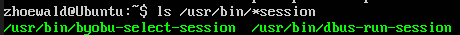

   - Узнаем версию Ubuntu, выполнив команду `cat /etc/issue`. Скриншот с выводом команды:

   

## Part 2. Создание пользователя ##

   * Вызов команды для создания пользователя: 

   

   * Вызов команды для добавления пользователя в группу adm: 

   

   * Скриншот с выводом команды `cat /etc/passwd`:

   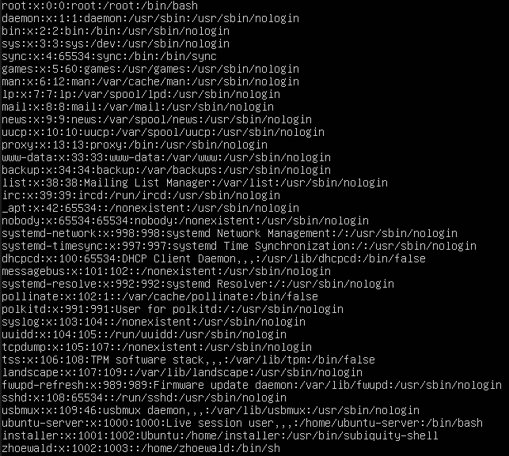

   (созданный пользователь на последней выведенной строке)

   ## Part 3. Настройка сети ОС ##

   * Зададим название машины вида user-1:

   

   Проверяем с помощью команды `hostnamectl | grep hostname` , что установилось нужное название

   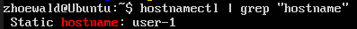

   * Установим временную зону, соответствующую текущему местоположению.

   

   Проверяем с помощью команды `timedatectl` , что установилась нужная временная зона

   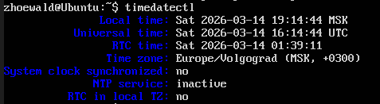

   * Выведем названия сетевых интерфейсов с помощью команды `ip link show`, которая отображает состояние сетевых интерфейсов.

   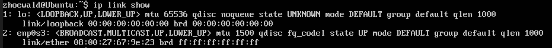
   
   - enp0s3 — это  имя сетевого интерфейса Ethernet в современных Linux-системах (systemd). Оно означает: en (Ethernet), p0 (шина PCI) и s3 (слот).
   - Интерфейс lo (loopback) — это виртуальный сетевой интерфейс в ОС Linux/Unix, предназначенный для внутренней связи компьютера с самим собой. 
   Он всегда активен, обеспечивает обмен трафиком через адрес 127.0.0.1 (localhost) без использования физических кабелей, используется для отладки, тестирования служб и работы локальных приложений.

   * Получим ip адрес устройства от DHCP-сервера с помощью команды `ip address`, предназначенной для управления и просмотра IP-адресов на сетевых интерфейсах:

   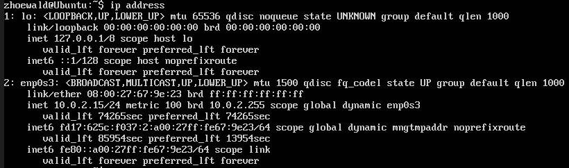

   - DHCP (Dynamic Host Configuration Protocol — протокол динамической настройки узла) — это сетевой протокол, автоматизирующий получение устройствами IP-адреса, маски подсети, шлюза и DNS-серверов.

   * Определим и выведем на экран внешний ip-адрес шлюза (ip) и внутренний IP-адрес шлюза, он же ip-адрес по умолчанию (gw).

      Узнаем внешний ip-адрес шлюза (ip), под которым наш шлюз виден в интернете с помощью команды `curl ifconfig.me`:

      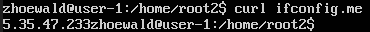

      
      Смотрим таблицу маршрутизации с помощью команды `ip route`: 

      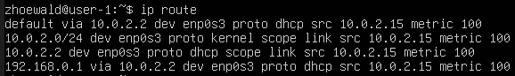

      Внутренний ip-адрес шлюза (или gateway) написан в строчке, начинающейся с default
   * Зададим статичные настройки ip, gw, dns

      - Откроем конфигурационный файл для редактирования настроек командой `sudo nano /etc/netplan/50-cloud-init.yaml`
      - Заменим содержимое файла следующим:

      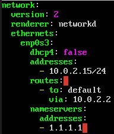

      - Проверим корректность написанного командой `sudo netplan try` и применим настройки:

         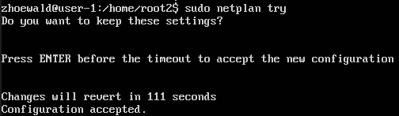

   * Перезагрузим виртуальную машину(командой `reboot`) и убедимся, что статичные сетевые настройки (ip, gw, dns) соответствуют заданным в предыдущем пункте.
      
      - Проверка ip

      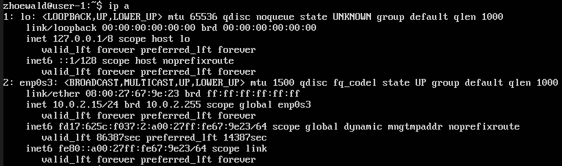

      - Проверка gw

      

      - Проверка dns

      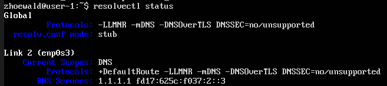

      - Пингуем удаленные хосты 1.1.1.1 и ya.ru 

      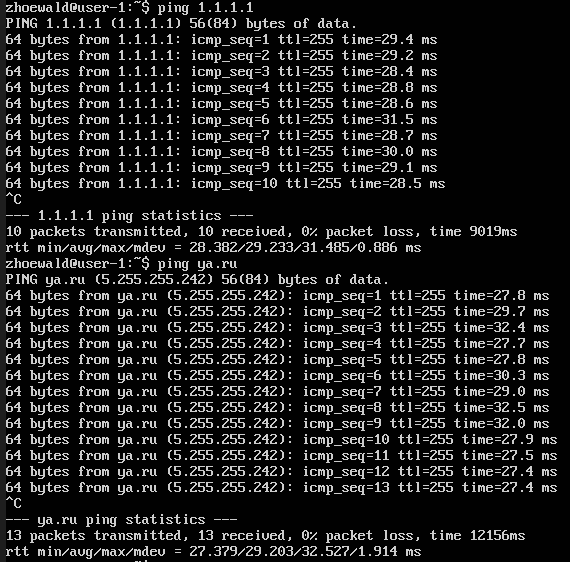

## Part 4. Обновление ОС
   
   - Обновим все системные пакеты в Ubuntu до самых свежих версий:

   

   - Если ввести команду обновления повторно, появится сообщение о том, что обновления отсутствуют:

   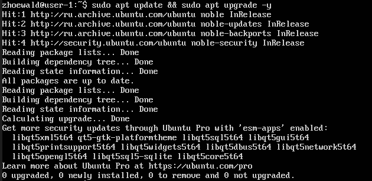

## Part 5. Использование команды sudo

   * Разрешим пользователю, созданному в Part 2,выполнять команду sudo, командой `sudo adduser zhoewald sudo`(добавим пользователя в группу sudoers).

   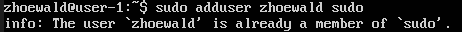
   
   (Написано, что пользователь уже в этой группе, т.к. я выдала права до выполнения этого пункта)

   * Sudo (substitute user do) — это команда , позволяющая обычным пользователям выполнять административные задачи с правами суперпользователя (root) или другого пользователя. Она обеспечивает безопасность, предоставляя временные высокие привилегии только для одной команды, вместо постоянного использования root-аккаунта.
   * Поменяем hostname ОС от имени пользователя, созданного в пункте Part 2 (используя команду `sudo hostnamectl set-hostname my-vm`).
   * Изменённое hostname:

   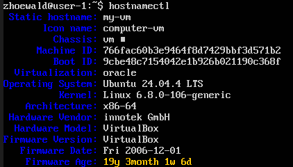

## Part 6. Установка и настройка службы времени

   * Настроим службу автоматической синхронизации времени командой `sudo timedatectl set-ntp true`

   * Выведем время часового пояса, в котором сейчас находимся:

   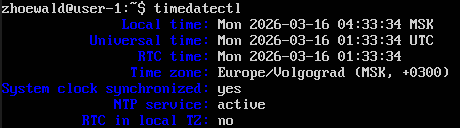

   * Вывод команды `timedatectl show`:

   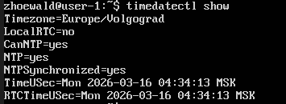

## Part 7. Установка и использование текстовых редакторов

   * Установим текстовые редакторы VIM, NANO, JOE 

   

   * Используя каждый из трех выбранных редакторов, создадим файл test_X.txt, где X — название редактора, в котором создан файл.

      + Тестируем VIM:

         - Откроем файл командой `vim test_vim.txt`. 
         - Перейдём в режим вставки нажатием `i`, введём текст:

         

         - Для сохранения и выхода нажмём `Esc` (возврат в командный режим) и введём команду `:wq`, завершив нажатием `Enter`.

      + Тестируем NANO:   

         - Откроем файл командой `nano test_nano.txt`. 
         - Введём текст. 

         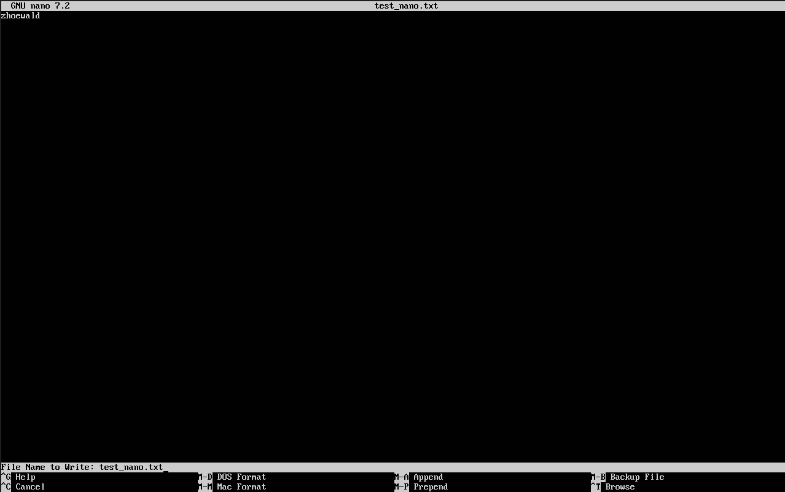

         - Для сохранения нажмём комбинацию клавиш `Ctrl + O`, подтвердим имя файла клавишей Enter и выйдем с помощью `Ctrl + X`.

      + Тестируем JOE:

         - Откроем файл командой `joe test_joe.txt`. 
         - Введём текст. 

         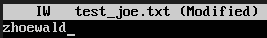

         - Для автоматического сохранения и немедленного выхода используем комбинацию `Ctrl + K` (вызов меню управления) и затем клавишу `X`.

   * Используя каждый из трех выбранных редакторов, открой файл на редактирование, отредактируем файл, заменив никнейм на строку «21 School 21», закроем файл без сохранения изменений.

      + Редактируем в VIM:

         - Откроем файл командой `vim test_vim.txt`. 
         - Перейдём в режим вставки нажатием `i`, сотрём старый текст, заменим на новый:

         

         - Для выхода без сохранения нажмём `Esc` (возврат в командный режим) и введём команду `:q!`, завершив нажатием `Enter`.

      + Редактируем в NANO: 

         - Откроем файл командой `nano test_nano.txt`.
         - Сотрём старый текст, заменим на новый:

         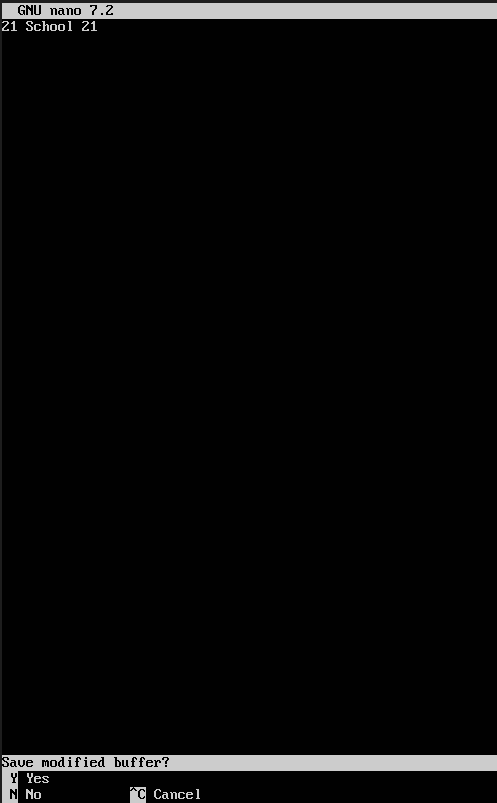

         - Нажмём `Ctrl + X`. На запрос системы «Save modified buffer?» нажмём клавишу `N` (No).
   
      + Редактируем в JOE: 

         - Откроем файл командой `joe test_joe.txt`.
         - Сотрём старый текст, заменим на новый:

         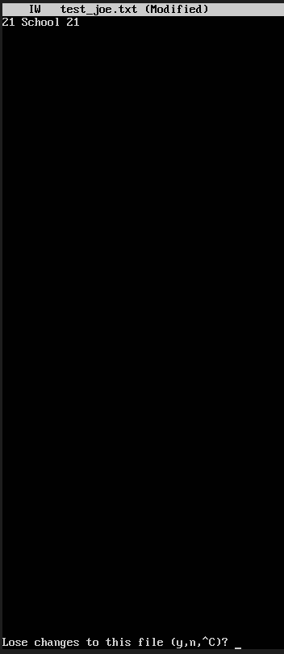

         - Нажмём комбинацию `Ctrl + C`. На появившийся запрос в верхней строке «Lose changes to filename? (y,n,^C)» нажмём клавишу `Y`.

   * Используя каждый из трех выбранных редакторов, отредактируем файл ещё раз, а затем освоим функции поиска по содержимому файла (слово) и замены слова на любое другое.
      + Ищем в VIM:
         - Сначала нажмём `Esc`, чтобы выйти из режима редактирования:
         - Для поиска введём `/`, затем искомое слово и нажмём `Enter`. Нажимать `n` для перехода к следующему совпадению.

            

      + Заменяем в VIM:
         - Введём команду: `:%s/zhoewald/21 School 21/g` и нажмём `Enter`.

            

      + Ищем в NANO:
         - Нажмём `Ctrl + W`, введём текст и нажмём `Enter`.

         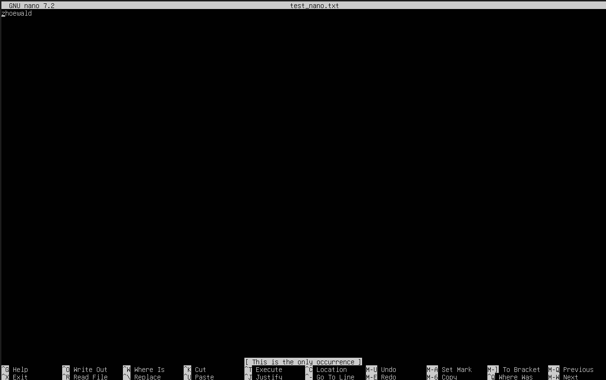

      + Заменяем в NANO:
         - Нажмём `Ctrl + \\`
         - Введём текст, который нужно найти, нажмём `Enter`.
         - Введём «21 School 21», нажмём Enter.
         - Нажмём `A`, чтобы заменить все совпадения.

         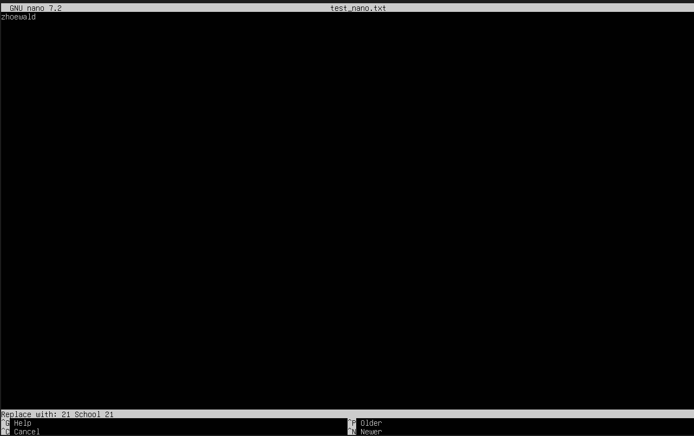

      + Ищем в JOE:
         - Нажмём `Ctrl + K` затем `F`.
         - Введём текст для поиска, нажмём `Enter`

         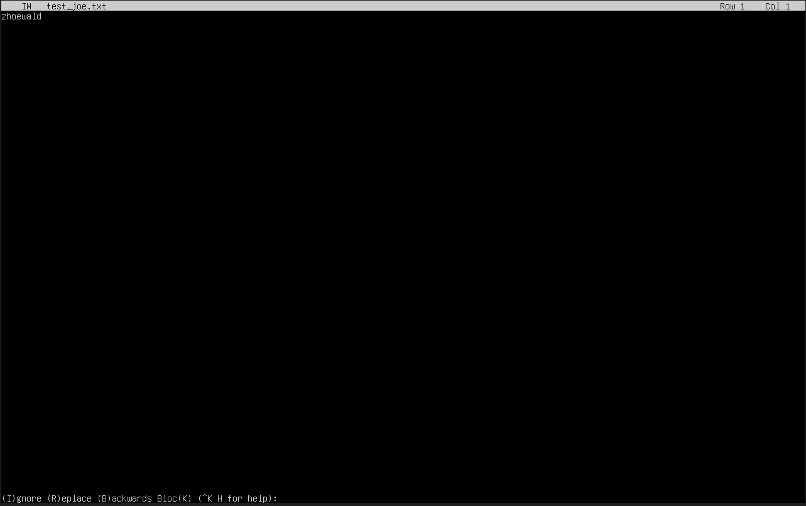

      + Заменяем в JOE:
         - После успешного поиска введём `R` (Replace) и нажмём `Enter`.
         - Введём `21 School 21`, нажмём `Enter`.
         - Нажмём `Y` для замены текущего слова

         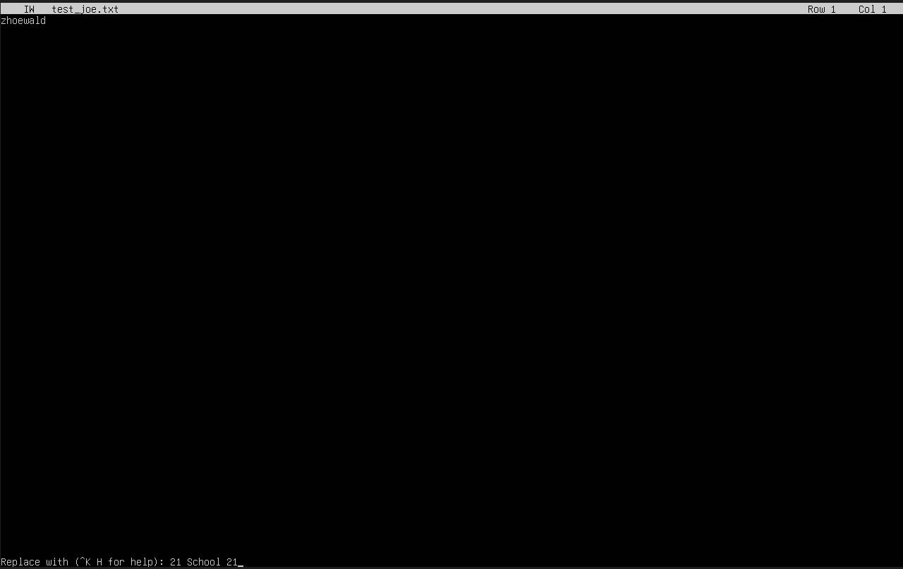

## Part 8. Установка и базовая настройка сервиса SSHD
   * Установим службу SSHd командой `sudo apt install openssh-server`:

   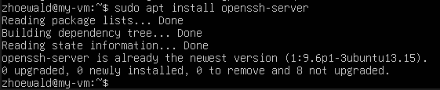

   * Добавим автостарт службы при загрузке системы командой `sudo systemctl enable sshd.service`.

   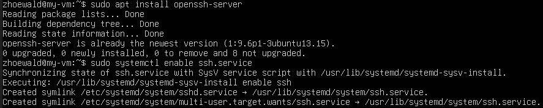

   * Перенастроим службу SSHd на порт 2022.
      - Откроем файл конфигурации командой `sudo nano /etc/ssh/sshd_config`
      - Найдём строку #Port 22 и раскомментируем её, изменив значение.

      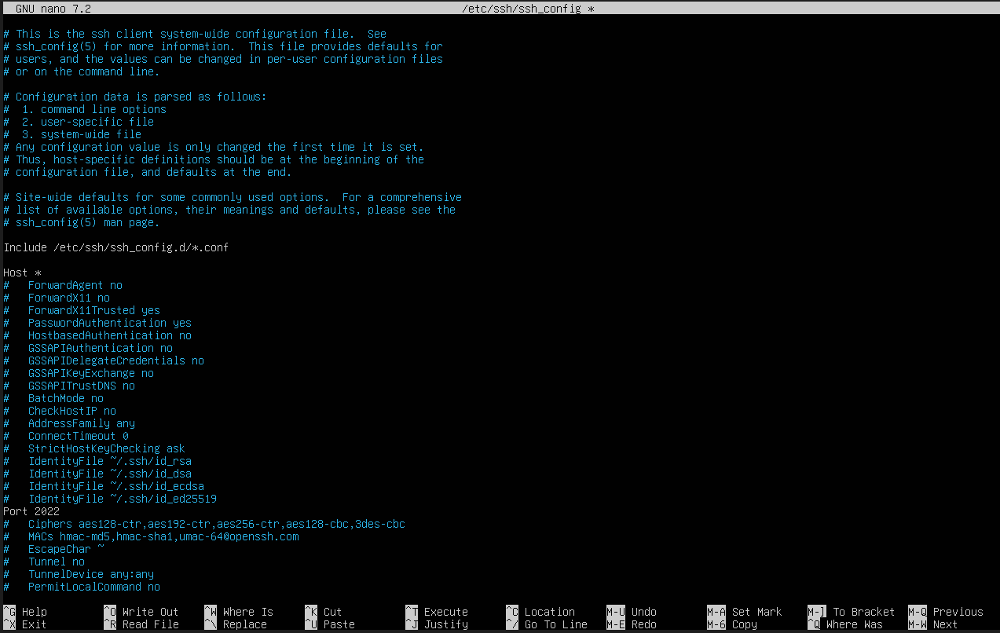

      - Сохраним файл и выйдем из редактора.

      - Перезапустим службу, чтобы изменения вступили в силу командой `sudo systemctl restart sshd`

   * Используя команду ps, покажем наличие процесса sshd. 

      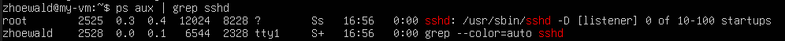

      Команда `ps` используется для получения информации о текущих процессах в системе. Поскольку процессов в системе много, мы используем её в сочетании с `grep`, чтобы отфильтровать только те строки, которые содержат слово `sshd`
   
   * Вывод команды netstat `-tan`:

      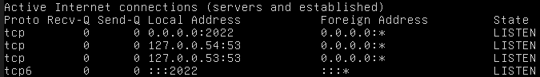

      `netstat` — утилита командной строки для отображения сетевых соединений, таблиц маршрутизации, статистики интерфейсов и сетевых протоколов.

      - Ключ `-t` (или `--tcp`) — показывает только TCP-соединения. Поскольку SSH работает поверх протокола TCP, нам интересны именно они.

      - Ключ `-a` (или `--all`) — показывает все соединения и ожидающие порты (сокеты), включая те, что находятся в состоянии ожидания (прослушивания — LISTEN), а не только активные установленные соединения.

      - Ключ `-n` (или `--numeric`) — отображает адреса и номера портов в числовом формате, без попытки преобразовать их в имена хостов или имена служб. Без этого ключа порт 2022 мог бы отобразиться как, например, blackjack (если такое имя есть в /etc/services), а 0.0.0.0 остался бы без изменений. Ключ -n гарантирует, что мы увидим именно цифру 2022.
      
   * Значение столбцов в выводе команды

      - Proto (Protocol): Протокол, используемый соединением. В нашем случае — tcp (IPv4) или tcp6 (IPv6).

      - Recv-Q (Receive Queue): Количество байт данных, ожидающих чтения приложением в очереди приёма для данного сокета. В норме должно быть 0.

      - Send-Q (Send Queue): Количество байт данных, ожидающих отправки в очередь отправки. В норме должно быть 0.

      - Local Address (Локальный адрес): Адрес и порт на локальной машине, который используется сокетом. Именно этот столбец нас интересует.

      - Foreign Address (Внешний адрес): Адрес и порт удалённой машины, с которой установлено соединение. Для сокетов, находящихся в режиме ожидания (LISTEN), это значение обычно обозначается как 0.0.0.0:* или :::*, что означает "любой удалённый хост и любой порт".

      - State (Состояние): Текущее состояние TCP-соединения. Для сервера, ожидающего входящие подключения, состояние должно быть LISTEN.

## Part 9. Установка и использование утилит top, htop
   * Установим утилиту htop командной `sudo apt install htop`(top предустановлена).
   * Запустим утилиту top командой `top`.

      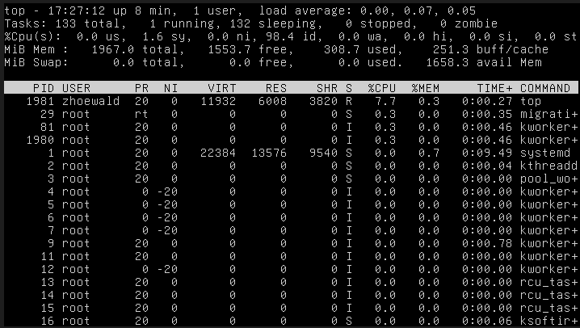

      По выводу команды `top` определим:
      |Параметр|Значение|
      |:-:|:-:|
      |uptime|8 минут|
      |количество авторизованных пользователей|1|
      |средняя загрузка системы|0.0 0.07 0.05|
      |общее количество процессов|133|
      |загрузка cpu|8.6%|
      |загрузка памяти|1%|                     
      |pid процесса занимающего больше всего памяти|1|
      |pid процесса, занимающего больше всего процессорного времени|1981|
   * Вывод команды `htop`:
      - отсортированному по PID

      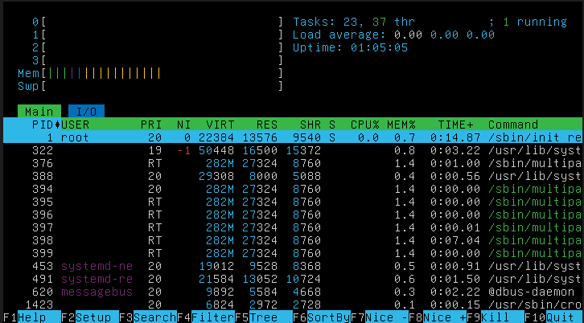

      - отсортированному по PERCENT_CPU

      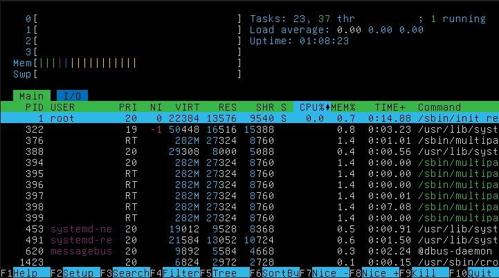

      - отсортированному по PERCENT_MEM
      
      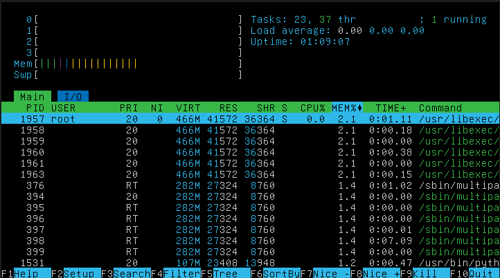

      - отсортированному по TIME
      
      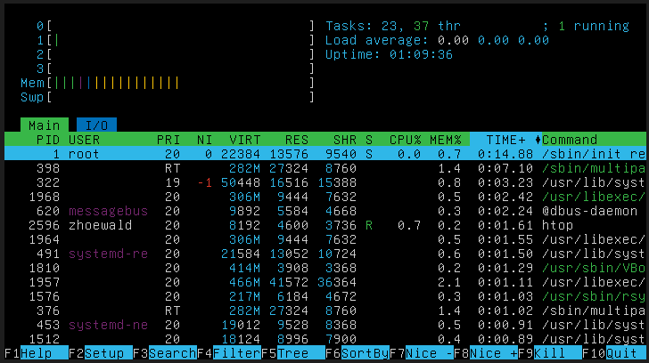

      - отфильтрованному для процесса sshd;

      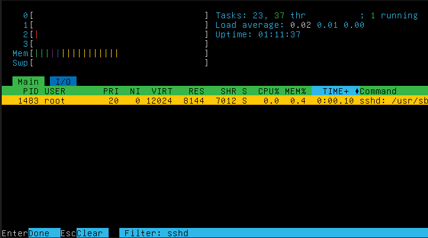

      - с процессом syslog, найденным, используя поиск

      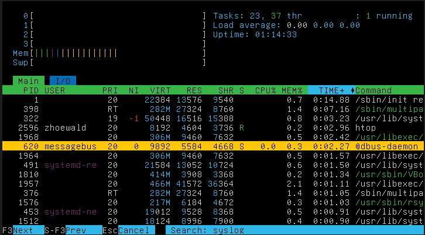

      - с добавленным выводом hostname, clock и uptime.

      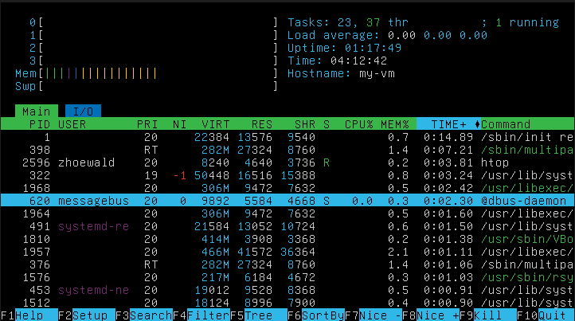

## Part 10. Использование утилиты fdisk

   * Вывод команды `fdisk -l`:

   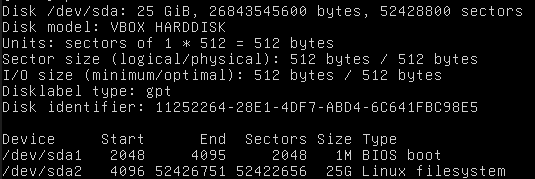

   * Информация из вывода fdisk:

   |Параметр|Значение|
   |:-:|:-:|
   |название жесткого диска|/dev/sda|
   |размер жесткого диска|25 Гб|
   |количество секторов|52428800|
   |размер swap|swap отсутсвует|

## Part 11. Использование утилиты df
   * Вывод команды `df`

   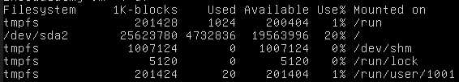

   |Параметр|Значение|
   |:-:|:-:|
   |размер раздела|25623780 Кб|
   |размер занятого пространства|4732836 Кб|
   |размер свободного пространства|19563996 Кб|
   |процент использования|20%|

   * Вывод команды `df -Th`

   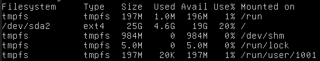

   |Параметр|Значение|
   |:-:|:-:|
   |размер раздела|25 Гб|
   |размер занятого пространства|4.6 Гб|
   |размер свободного пространства|19 Гб|
   |процент использования|20%|

## Part 12. Использование утилиты du

   * Вывод команды `du`

   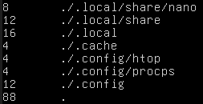

   * Вывод размера папок /home, /var, /var/log в байтах 

   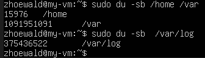

   * Вывод размера папок /home, /var, /var/log в человекочитаемом виде

   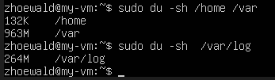

   * Вывод размера всего содержимого в /var/log

   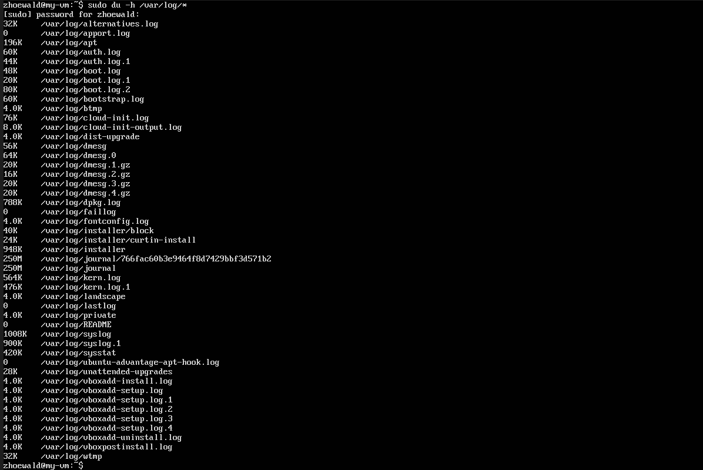

## Part 13. Установка и использование утилиты ncdu
   * Установим утилиту ncdu командной `sudo apt install ncdu`
   * Вывод размера папок /home, /var командной `sudo ncdu /`

   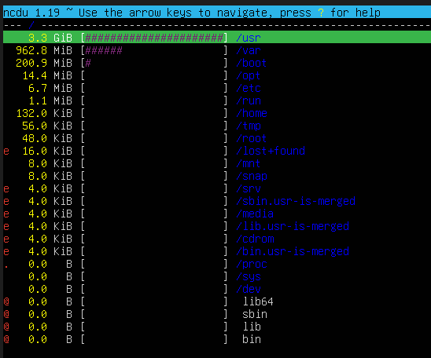

   * Вывод размера папки /var/log

   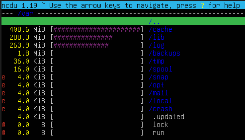

   |Папка|Размер(ncdu)|Размер(du)|
   |:-:|:-:|:-:|
   |/home|132 Кб|132 Кб|
   |/var|963 Мб|963 Мб|
   |/var/log|264 Мб|264 Мб|

## Part 14. Работа с системными журналами

   * Открем для просмотра:

      1. /var/log/dmesg командной `less /var/log/dmesg`

      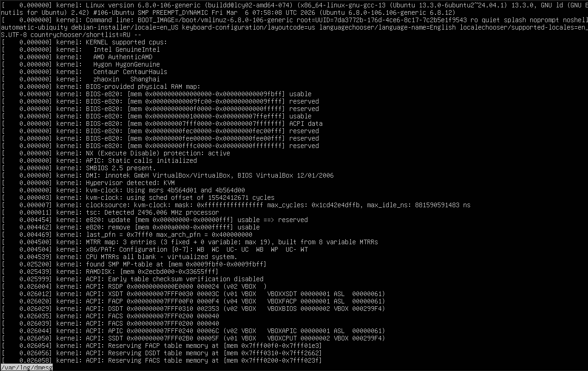

      2. /var/log/syslog командной `less /var/log/syslog`

      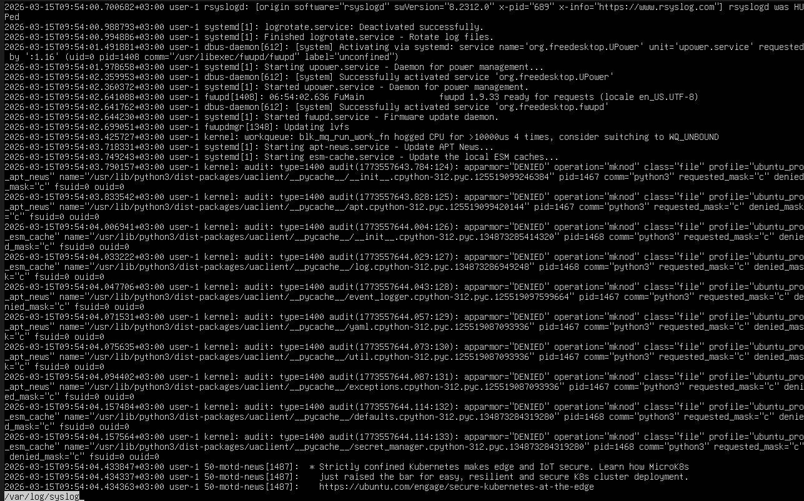

      3. /var/log/auth.log командной `less /var/log/auth.log`

      

   * Узнаем время последней успешной авторизации, имя пользователя и метод входа в систему.

   

   - время последней успешной авторизации: 2026-03-20 01:57:02
   - имя пользователя: zhoewald
   - метод входа в систему: Консольный вход (TTY)

## Part 15. Использование планировщика заданий CRON

   * Для редактирования заданий текущего пользователя используем команду `crontab -e`.
   * Добавим строку `*/2 * * * * /usr/bin/uptime` в файле crontab
   * Найдём в системных журналах строчки о выполнении

   

   * Выведем на экран список текущих заданий для CRON

   